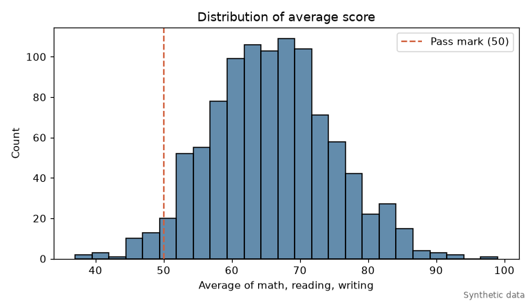
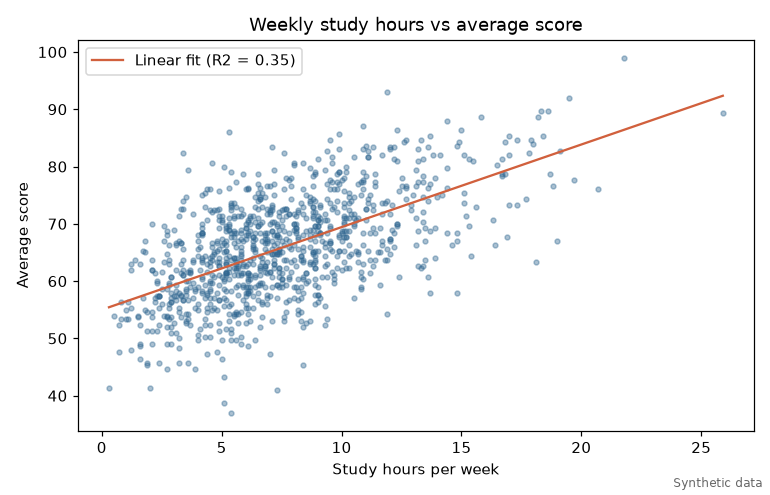
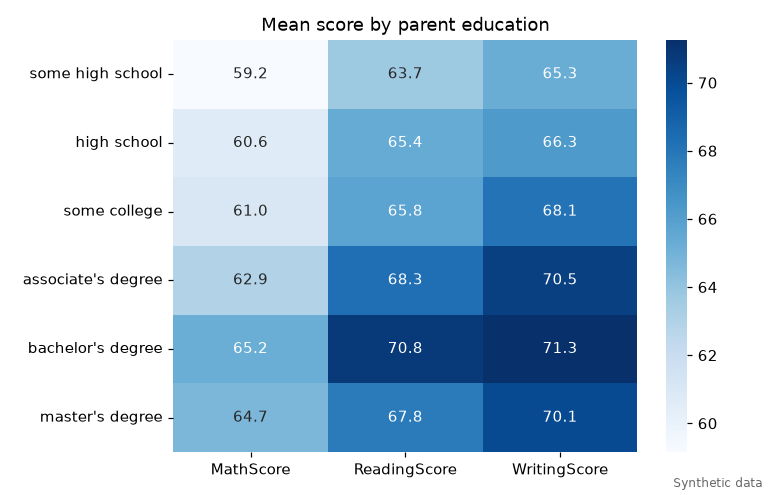
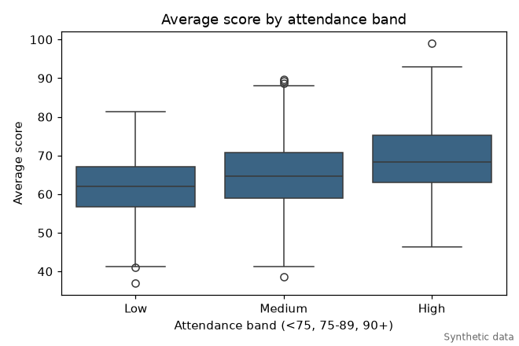
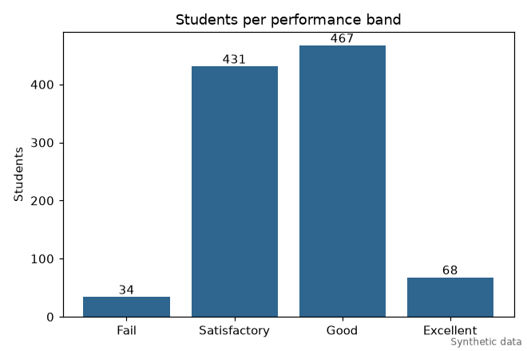
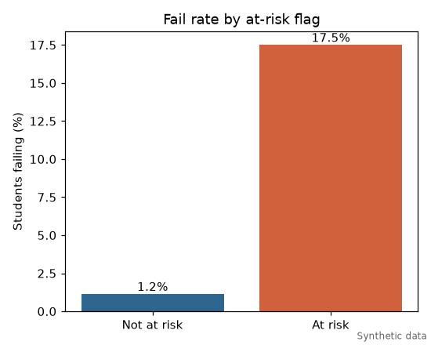

# Academic Insight Engine

A small Python package for analysing student performance: load a table of student records, validate and clean it, derive features (pass flag, performance and attendance bands), run descriptive statistics, correlations, group comparisons, an at-risk rule and a linear regression, and write a markdown report with charts.

Stack: Python 3.10+, pandas, numpy, matplotlib, seaborn, pytest, ruff, GitHub Actions.

## The data is synthetic

This project grew out of an exploratory notebook (kept in `legacy/`) that read a spreadsheet called `Expanded_data_with_more_features`. That file is not in the repository, so the analysis could not be reproduced.

To make the pipeline runnable, `academic_insight/synthetic.py` generates a seeded fake dataset with the same kind of columns the notebook used (`Gender`, `ParentEduc`, `ParentMaritalStatus`, `WklyStudyHours`, `MathScore`, `ReadingScore`, `WritingScore`) plus extra ones (`StudyHours`, `AttendanceRate`, `PreviousGrade`, `ParentalSupport`).

It is not real student data. The relationships in it (more study and better attendance give higher scores, a small bonus for parent education) are assumptions written into the generator, so anything the report "finds" on it only reflects those assumptions. Generated files are named `synthetic_students.csv`, charts carry a "Synthetic data" note, and reports on such files start with a warning.

## Setup

```
python3 -m venv .venv
.venv/bin/pip install -r requirements-dev.txt
```

`make setup` does the same.

## Usage

```
# create a synthetic dataset (default 1000 students, seed 42)
.venv/bin/python -m academic_insight generate --n 1000 --seed 42 --out data/synthetic_students.csv

# analyse any CSV/Excel file with the expected columns
.venv/bin/python -m academic_insight report --input data/synthetic_students.csv --out-dir output
```

`generate` also takes `--missing-rate` to blank some `ParentEduc` values, which exercises the cleaning step. `report` writes `report.md` and a `charts/` folder with six PNGs into `--out-dir`. If you have a real file with the required columns (see `academic_insight/schema.py`), `report` works on it too; the synthetic warning is only added when the file name contains "synthetic".

`make data`, `make report`, `make test` and `make lint` are shortcuts.

The committed example output is in [docs/sample-report.md](docs/sample-report.md). It was produced with the commands above (1000 students, seed 42).








## At-risk rule

A student is flagged when at least 2 of 3 signals hold. Comparisons are strict, so a value exactly on a threshold is not a signal.

- attendance below 75%
- fewer than 5 study hours per week
- previous grade below 60

The thresholds are constants at the top of `academic_insight/analysis.py`. They are a simple rule of thumb, not a validated model.

## Structure

```
academic_insight/
  schema.py      expected columns, value ranges, category labels
  synthetic.py   seeded synthetic dataset generator
  loading.py     read CSV/Excel, validate schema (SchemaError lists every problem)
  cleaning.py    drop index columns and duplicates, normalise labels, handle missing values
  features.py    AverageScore, Passed, PerformanceBand, AttendanceBand
  analysis.py    descriptive stats, correlations, group means, at-risk rule, OLS regression
  charts.py      six matplotlib/seaborn charts saved as PNG
  report.py      markdown report builder
  cli.py         `generate` and `report` commands
tests/           pytest suite
docs/            sample report and charts (synthetic)
legacy/          the original notebook and script, unchanged
.github/workflows/ci.yml
```

## Tests

```
.venv/bin/python -m pytest
.venv/bin/python -m ruff check .
```

The suite has 86 tests: hand-made frames with known answers for features, analysis and cleaning; generator checks (same seed gives same data, value ranges, no unexpected nulls); schema validation errors; at-risk boundary cases; and CLI tests that generate a dataset and run the full report in a temporary directory.

CI (`.github/workflows/ci.yml`) runs ruff and pytest on Python 3.10, 3.11 and 3.12. It has not been run on GitHub from this checkout.

## Limitations

- The data is synthetic, so no result here says anything about real students.
- The original notebook's findings (for example parent education and marital status effects) could not be reproduced without its dataset.
- Pass mark, band edges and at-risk thresholds are arbitrary defaults.
- Regression is a plain linear fit with no train/test split or significance tests; correlation does not imply causation.
- Cleaning fills missing numeric predictors with the median and drops rows with missing scores; that may not suit other datasets.
- Developed locally on Python 3.13; 3.10 to 3.12 are covered only by the CI configuration. The workflow file was checked as valid YAML but not with actionlint, because its binary could not be downloaded in the build environment.
