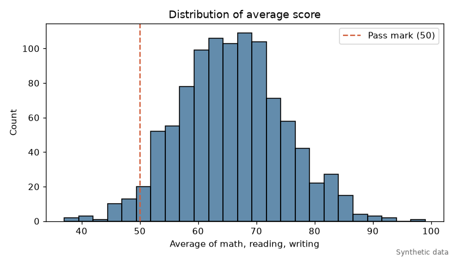
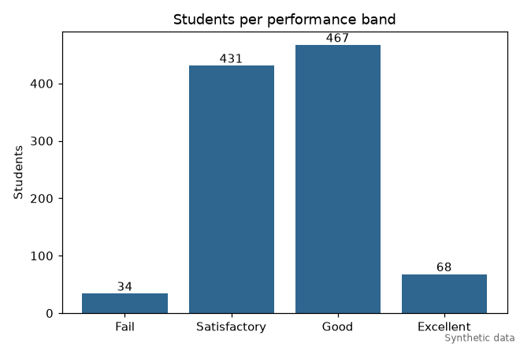
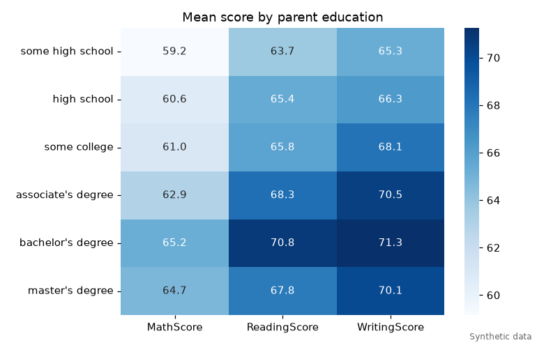
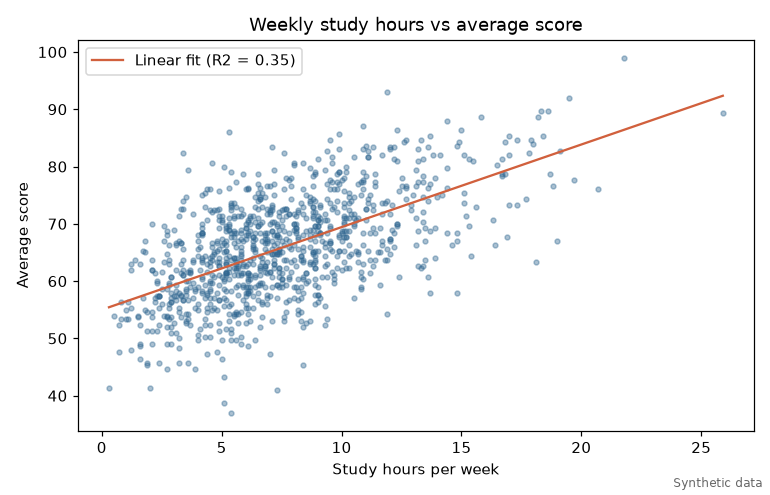
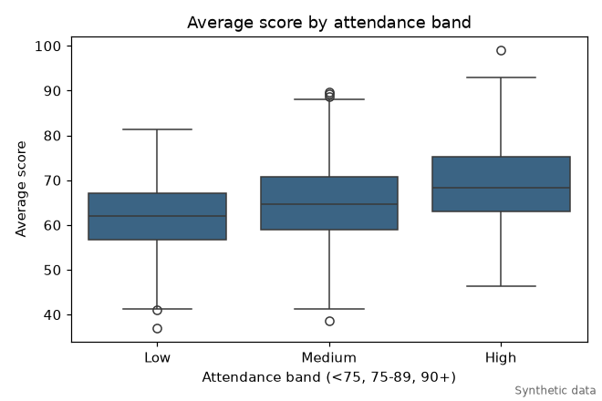
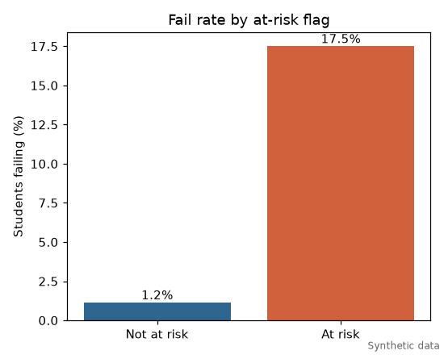

# Academic Insight report

> SYNTHETIC DATA. The numbers below come from a seeded generator, not from real students. They show the pipeline working, not facts about any school.

Source file: `synthetic_students.csv`  
Students: 1000

## Score summary

| Item | count | mean | std | min | 50% | max |
|---|---|---|---|---|---|---|
| MathScore | 1000.00 | 62.12 | 11.36 | 22.00 | 62.00 | 99.00 |
| ReadingScore | 1000.00 | 66.97 | 10.86 | 33.00 | 67.00 | 99.00 |
| WritingScore | 1000.00 | 68.57 | 10.53 | 36.00 | 68.00 | 100.00 |
| AverageScore | 1000.00 | 65.88 | 9.02 | 37.00 | 65.67 | 99.00 |

Pass mark: average score of 50 or more. Passed: 966 of 1000 (96.6%).

## Correlation with average score

| Item | pearson_r |
|---|---|
| PreviousGrade | 0.669 |
| StudyHours | 0.593 |
| AttendanceRate | 0.318 |
| ParentalSupport | 0.169 |

## Linear regression on average score

Intercept 3.57, R2 0.726.

| Item | coefficient |
|---|---|
| StudyHours | 1.125 |
| AttendanceRate | 0.217 |
| PreviousGrade | 0.470 |
| ParentalSupport | 1.385 |

## Group comparisons (mean scores)

By gender:

| Gender | MathScore | ReadingScore | WritingScore |
|---|---|---|---|
| female | 61.75 | 68.37 | 70.37 |
| male | 62.51 | 65.45 | 66.61 |

By parent education:

| ParentEduc | MathScore | ReadingScore | WritingScore |
|---|---|---|---|
| associate's degree | 62.95 | 68.30 | 70.54 |
| bachelor's degree | 65.21 | 70.83 | 71.25 |
| high school | 60.62 | 65.36 | 66.27 |
| master's degree | 64.69 | 67.78 | 70.06 |
| some college | 61.01 | 65.77 | 68.10 |
| some high school | 59.16 | 63.73 | 65.26 |

By parent marital status:

| ParentMaritalStatus | MathScore | ReadingScore | WritingScore |
|---|---|---|---|
| divorced | 62.31 | 66.64 | 68.03 |
| married | 61.99 | 67.35 | 68.82 |
| single | 61.95 | 65.95 | 68.11 |
| widowed | 63.47 | 68.12 | 69.65 |

Pass rate by attendance band:

| AttendanceBand | pass_rate |
|---|---|
| Low | 0.915 |
| Medium | 0.963 |
| High | 0.991 |

## At-risk students

A student is flagged when at least 2 of these hold: attendance below 75%, study hours below 5 per week, previous grade below 60.

Flagged: 137 of 1000 (13.7%). Fail rate among flagged: 17.5%; among the rest: 1.2%.

## Charts

